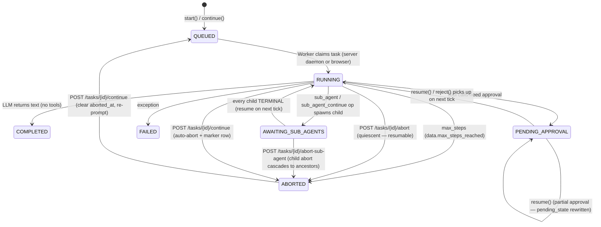

# Agent Loop: Async Architecture

## Overview

The Orchestrator loop is synchronous by design — no external queue daemon is required. Each `Orchestrator::start()` returns once the task is `QUEUED` (or, in legacy dev mode, `RUNNING`); a worker (server daemon or browser `SharedWorker`) calls `tick()` to drive the task to a terminal state. The deployment choice — server daemon, browser worker, with or without Mercure — lives in [Deployment modes](/reference/concepts/deployment-modes). The mechanics below (tick phases, task lifecycle, Mercure publishing) are identical across all three configurations.

The `WorkerMode` enum at `app/Agents/ValueObjects/WorkerMode.php` is single-case (`Worker`) — the legacy `WorkerMode::Sync` was removed when `SPORA_SYNC_MODE` was replaced. The new `WorkerRuntimeMode` enum (`server` / `client`) gates which CLI commands and HTTP routes are active; see [Environment variables → Worker runtime mode](/start/operators/env-vars#worker-runtime-mode) and [Client-worker mode](/deploy/shared-host/client-worker-mode).

## Tick Structure

`Orchestrator::tick()` runs in three phases to avoid holding a DB lock during the LLM round-trip:

**Phase 1 — Claim (short transaction with `lockForUpdate`)**

- Lock the task row
- Validate `status === 'RUNNING'`
- Abort early if `step_count >= max_steps` (flips to `ABORTED` via `TaskStatusWriter::autoAbortTransition($task, 'max_steps_reached', true)` so the existing follow-up flow covers continuation; the row carries `data.max_steps_reached: true` so the UI can label the banner — added in spora-core PR #266)
- Commit → lock released

### Phase 2 — Load + LLM call (outside the transaction)

- Load agent, enabled tools, system prompt, and `LLMRequest` (no DB lock held)
- `Task::where('id', $taskId)->increment('step_count')`
- Blocking HTTP call to the configured LLM provider
- No DB connection held during the I/O round-trip

### Phase 3 — Write results

- If tool calls: `appendHistory`, execute tools, then either call `tick()` again or pause for approval (`PENDING_APPROVAL`)
- If text response: `appendHistory`, set `COMPLETED`

`safeExecute()` reads the calling agent's row inside the Orchestrator, resolves ownership from it, and threads that into `execute()` as a `PrincipalContext` (read `$context->ownerUserId`) — tools never see a session-derived user id, so async contexts (server-mode daemon, browser-driven `SharedWorker`, scheduled runs, sub-agent hops) all inherit the same trust boundary. See [Architecture → Orchestrator Loop](/reference/concepts/architecture#orchestrator-loop) for the invariant.

`resume()` (PR #173) takes a per-call `decisions` list and splits it via `AgentDecisionProcessor::splitDecisions()` into approved and rejected subsets inside a single `lockForUpdate()` transaction. Approved rows are handed to `ApprovedBatchExecutor` (PR #171 path — partial-approval semantics preserved: undecided rows stay `PENDING_APPROVAL`). Rejected rows are stamped `REJECTED` with `rejected_at` / `rejected_by` / `reject_reason` and a `role:'tool'` history row is appended carrying `toolCallId` + `toolName` so the LLM sees the rejection in its next round-trip. The task transitions back to `QUEUED` only when the batch leaves no `PENDING_APPROVAL` rows; partial-approval batches keep the task paused. `reject()` (task-level bulk) is unchanged in shape but does not write the per-call rejection columns. `ApprovedBatchExecutor` records worker-mode approvals with `executed_at IS NULL` as the "approved, awaiting execution" sentinel for the daemon's next drain (server mode) or the browser's next `/tick` (client mode).

**Partial approval.** When the LLM produced parallel tool calls and the operator approves only some of them, `resume()` does not transition the task out of `PENDING_APPROVAL` — it rewrites `pending_state` with the un-approved tool calls and returns, so the operator can keep deciding on later rounds. Un-approved `tool_calls` rows stay at `status='PENDING_APPROVAL'`; they are never silently executed with the LLM's original arguments, and never auto-rejected.

**Worker-mode tool pickup.** In Worker mode, `resume()` persists each approved tool as `status='APPROVED'` with `executed_at=NULL` (the worker-pickup sentinel) and returns without running the tool. When the daemon's `task:run` worker claims the resulting `QUEUED` task and runs `tick()`, `TickPhaseRunner::runTick()` calls `executeApprovedPendingToolsForTask()` first — it picks up those `APPROVED` + `executed_at IS NULL` rows, validates, executes, and appends the tool result to history — _before_ the LLM round-trip. The next assistant message therefore sees the tool results on the same round-trip. The HTTP `POST /api/v1/tasks/{id}/approve` response returns within ~100 ms regardless of how long the approved tool takes.

## Task Status Lifecycle



### Quiescent task states

`ABORTED`, `PENDING_APPROVAL`, and `AWAITING_SUB_AGENTS` together form the **quiescent** set: in every case the worker is not driving the task — the conversation is waiting on the operator (`PENDING_APPROVAL` tool call), on sub-agent children (`AWAITING_SUB_AGENTS`), or on the operator's next instruction after an explicit halt (`ABORTED`). The chat detail poller skips the entire set so the browser does not waste cycles fetching a task that is not making progress on its own. The poller re-arms the moment an action moves the task out — approve/reject from the approval bar, sub-agent child reaching a terminal state, or `POST /api/v1/tasks/{taskId}/continue` resuming an ABORTED task.

`AWAITING_SUB_AGENTS` is the suspended-while-sub-agent-children-run state set by the `SubAgentTool` `sub_agent` op — and by `sub_agent_continue`, which waits on an existing child the same way. Each spawn creates a regular `Task` with `parent_task_id` and bumps `data.sub_agent_expected_count` after the child tick. The first spawn also sets `data.sub_agent_batch_open` to `true` — a per-batch cross-process lock that prevents the per-child resume hook from racing the batch-boundary hook in worker mode. The resume gate compares the live child count from `data.spawned_sub_task_ids` against `sub_agent_expected_count` and only re-enters the loop when every sibling has reached a terminal state; the boundary hook then clears `sub_agent_batch_open` along with the other batch book-keeping. The next worker pickup (server daemon's `task:run` or browser's `/tick`) drains it via `TickPhaseRunner::maybeResumeParentFromBatchBoundary`. See [Tool system → Sub-Agent tool](/reference/concepts/tools#sub-agent-tool) for the LLM-facing contract.

The third operation, `handover`, never reaches `AWAITING_SUB_AGENTS`: the target's task is created and left to the worker in the background, and it is deliberately kept out of `data.spawned_sub_task_ids`, so it cannot hold the parent's resume gate open. The source chat keeps running and ends on the agent's own closing message.

## Parked work and operator input

`AWAITING_INPUT` is the fourth quiescent state, the parallel to `PENDING_APPROVAL`: the task is waiting on the operator to answer a question the model asked, not to approve a tool call. It is in `TaskLifecyclePolicy::QUIESCENT_STATUSES`, and `ToolCallDisposition::AwaitingInput` is the parallel to `AwaitingApproval`.

An `ask_user_question` batch is persisted on `tasks.pending_state` under the `pending_questions` key, beside the existing `pending_tool_calls` that back `PENDING_APPROVAL`:

```jsonc
{
  "tool_call_id": "call_01HX...",
  "questions": [
    {
      "question": "Which database backend should we use?",
      "header": "DB backend",
      "options": [
        { "label": "SQLite", "description": "Zero-config, single file", "preview": null },
        { "label": "MySQL", "description": "Shared hosting friendly", "preview": null },
      ],
      "multiple": false,
      "allowFreeText": true,
    },
  ],
  "created_at": "2026-09-19T10:30:00+00:00",
}
```

Several batches may coexist when the model invokes `ask_user_question` across separate turns. The Mercure intermediate-state event publishes `pending_questions` whenever the task is in `AWAITING_INPUT`, so the chat UI renders the picker without a follow-up fetch.

`POST /api/v1/tasks/{taskId}/answer` submits the operator's answers. The batch is answered atomically: the request must carry exactly one answer per question in the batch, keyed by `header`.

```jsonc
{
  "tool_call_id": "call_01HX...", // must match a pending batch
  "answers": [
    // exactly one entry per question
    {
      "header": "DB backend", // must match question.header
      "selections": ["SQLite"], // list of selected option labels
      "free_text": null, // only when allowFreeText is true
    },
  ],
}
```

On success the answer is appended as a single `role:tool` history row carrying every formatted answer — one row per batch, mirroring the orchestrator's batched-tool-call pattern. The task flips to `QUEUED` when no batches remain pending, and stays `AWAITING_INPUT` while any other batch is still open. A `404` means the task is not the caller's; a `422` means the body was malformed, the `tool_call_id` matches no pending batch, the answer count differs from the question count, a `header` or `selections` label is unknown, or `free_text` was sent for a question that does not allow it.

## Context window and compaction

A long conversation eventually outgrows the model's context window. `ConversationCompactor` handles that by summarising the older part of the history: the model reads the summary instead of the turns it covers, and the turns themselves stay in the transcript.

**The summarized turns are not deleted.** They stay in `task_history` with their sequences untouched, so the operator can still read them in the chat. What changes is what the model is sent: `MessageHistoryBuilder` drops the rows the summary covers and sends the summary in their place, at the position the range starts. A summary whose range a later, wider summary covers is redundant — the wider one was written from it — so it is dropped rather than sent.

A compaction appends one `role=summary` row at the end of the history, carrying the sequence range it replaces in `summarized_sequence_range`:

```jsonc
{
  "sequence": 8,
  "role": "summary",
  "content": "The agent read the page and answered…",
  "summarized_sequence_range": "0-2",
}
```

Appending rather than inserting is what keeps every existing row's sequence stable — `task_history` carries a unique index on `(task_id, sequence)`, so an inserted row would have to shift every row after it, and the SPA's `since_sequence` cursor is built on those sequences staying put. It also puts the summary above the SPA's cursor, so the next poll delivers it.

### What the summariser sees

The summary request carries the conversation, with three bounds on it — and it carries the summaries already in force along with it, because a summary is the model's only memory of the rows it covers.

**The output budget.** The summary is a model turn, and a reasoning model spends its output budget on thinking before it writes anything. The old cap of 1024 tokens left a reasoning model with nothing to write the summary with: it returned `finish_reason: length`, an empty message, and the compaction wrote that empty message in place of the summarized turns — the worst outcome a compaction can have, since the model loses the context of sixty turns and gets nothing in its place. The summary request now gets the agent's own output budget, capped at 8192 tokens — `min(max_tokens_output, 8192)` — so a reasoning model has room to think and still write.

**The tool results.** Tool results are the bulk of a long conversation — one research turn can carry tens of thousands of tokens of search output. Handed over in full, the model thinks for tens of thousands of tokens, exhausts its budget before writing anything, and takes two minutes doing it. The summariser sees the head of each result instead: the compactor prepends the tool's name and keeps the first 1000 characters of the result. Whether the tool's query is inside that head depends on the tool's own output format — the compactor does not know what a given tool puts at the front.

**The data URLs.** Every row's content goes through `ScrubDataUrls::scrub()` first, which replaces each base64 `data:` URL with `[data-omitted]`. One multi-megabyte image would otherwise overflow the summariser's own context window.

The summariser also gets a neutral system prompt rather than the agent's persona. It is not the agent, and the persona's report is the opposite of what a compaction needs.

If the model still returns nothing, the compaction fails: the compactor raises `CompactionFailedException`, the endpoint answers `500 COMPACTION_FAILED`, and **the history is left unchanged**. A compaction that produces no summary must not replace the turns it was meant to summarize.

### Two ways to trigger one

**Automatically**, when the provider reports a context-window error. `ContextWindowRecovery` compacts the history and re-ticks — except in client-worker mode, where the tick is a single step (`singleStep`): there it re-throws the original context-window error instead of re-ticking, and the row is left `RUNNING` with a live lease for the reaper to flip to `FAILED`. It also short-circuits before compacting when the task has one history row or fewer — there is nothing to summarise, so the task is marked `FAILED` with the error code `CONTEXT_WINDOW_FIRST_TURN` and the original error is re-thrown.

**Manually**, through `POST /api/v1/tasks/{taskId}/compact`:

```http
POST /api/v1/tasks/42/compact
```

```jsonc
{
  "data": {
    "task": {/* the task detail resource */},
    "compacted": true,
  },
}
```

It summarises everything but the last five rows (`ConversationCompactor::KEEP_ROWS = 5`): the model gets the summary in place of those rows, and the rows stay in the transcript. `compacted` is `false` when the history was too short to summarize, which leaves the task untouched. A `409` means the task is not in a state that can be compacted — only `COMPLETED`, `FAILED` and `ABORTED` can be, because a running task is mid-turn and the tick writes rows as it goes, so a compaction would race it. A `500` with `COMPACTION_FAILED` means the model returned no summary; the history is unchanged. A `404` means the task is not the caller's.

### In the chat

The command menu on the follow-up bar — the shell-prompt button next to the attach buttons — carries the task commands. "Compact conversation" asks the backend for one. The composer is gone while it runs: the call appends a summary row to the history the next prompt would be appended to, and it takes a model round trip. The **Compacting the conversation…** indicator sits in the transcript, beside the other in-flight states, because there is no composer left to carry it.

The compaction leaves a mark in the transcript rather than replacing anything: the summary row is appended to the history where the compaction happened, so the chat shows a collapsed **N messages compacted** marker at that point — expanded, what the model was told. The turns the summary stands in for stay in the transcript, right where they were.

The marker's position is the summary row's own sequence, which is where the compaction was written: the row is appended to the history at that moment. A conversation can be compacted more than once, and each compaction leaves its own marker — the later one covers everything the earlier one did, because its range starts where the earlier range started.

## Task data keys

Two working sets ride on the `tasks.data` JSON column rather than on their own tables, and both are visible to the operator without an extra API because the column is already serialised into the `TaskDetail` payload and onto Mercure events.

`tasks.data.todos` holds the `todo` tool's working list:

```jsonc
{
  "version": 1,
  "items": [
    {
      "id": "t_01HX...",
      "content": "Migrate notes table to new schema",
      "activeForm": "Migrating notes table to new schema",
      "status": "in_progress", // pending | in_progress | completed
      "order": 0,
    },
  ],
  "updated_at": "2026-09-19T10:30:00+00:00",
}
```

`ConversationCompactor` summarises the older part of a task's history when the provider reports a context-window error, but it never touches `tasks.data` — so the todo list survives compaction. See [Context window and compaction](#context-window-and-compaction).

`tasks.pending_state.pending_questions` holds the parked question batches described above.

## Worker CLI

Server mode only. The CLI commands below are the operator's tools for `worker_runtime_mode: server`. In `client` mode the same commands exit with a docs-link error — see [Client-worker mode](/deploy/shared-host/client-worker-mode) for the browser-driven equivalent.

**Entry point:** `bin/spora` (via `WorkerRunCommand`)

```bash
# Default: persistent daemon — continuously polls for scheduled runs and QUEUED tasks
php bin/spora worker:run

# One-shot scheduled runs only, then exit
php bin/spora worker:run --once

# One-shot: scheduled runs + QUEUED tasks, then exit
php bin/spora worker:run --once --include-queue

# Orphan reaper: mark stale RUNNING tasks as FAILED, then exit
php bin/spora worker:run --reap-only

# Options
--limit=N         Max QUEUED tasks per poll cycle (0 = unlimited, default: 0)
--sleep=N         Microseconds to sleep when queue is empty (default: 500000)
--stale-minutes=N Minutes before a RUNNING or AWAITING_SUB_AGENTS task is considered orphaned (0 = disabled; omit to use config default of 60)
--workers=N       Max concurrent child processes (0 = unlimited)
--once            Process due scheduled runs then exit (one-shot)
--include-queue   With --once: also drain the QUEUED task queue
--reap-only       Reap orphaned RUNNING tasks once, then exit
--daemon          Explicit daemon mode (default when no flag is given)
```

### Deployment modes

| Command                             | Scheduled runs | QUEUED tasks | Exit                  | Typical use                           |
| ----------------------------------- | -------------- | ------------ | --------------------- | ------------------------------------- |
| `worker:run`                        | ✓              | ✓            | Never (until SIGTERM) | VPS/Docker always-on (default daemon) |
| `worker:run --reap-only`            | —              | —            | After one iteration   | Maintenance: orphan reaping only      |
| `worker:run --once`                 | ✓              | —            | After processing      | Cron for scheduled runs               |
| `worker:run --once --include-queue` | ✓              | ✓            | After processing      | Full cron replacement                 |

For the **client-mode** equivalent (browser-driven, no daemon), see [Client-worker mode](/deploy/shared-host/client-worker-mode) and the [Deployment modes](/reference/concepts/deployment-modes) overview.

**Cron setup:**

```cron
# Full queue drain every minute
* * * * * /usr/bin/php /path/to/spora/bin/spora worker:run --once --include-queue >> /path/to/spora/storage/worker.log 2>&1
```

The daemon (`--daemon`) uses the same `storage/spora-worker.lock` as the one-shot modes, preventing concurrent workers. After each scheduled run, `next_run_at` is computed using wall-clock `now` (in the schedule's timezone) as the cron reference — not the actual last run time — so arbitrarily-delayed cron invocations are handled correctly without drift.

For the full deployment reference (Docker, systemd, supervisord, reaping, single-instance enforcement, monitoring), see the [Worker deployment](/reference/concepts/worker-deployment) page.

## Mercure SSE (Optional — Docker / FrankenPHP)

When `SPORA_MERCURE_URL` and `SPORA_MERCURE_JWT_KEY` are set, the `Orchestrator` publishes task state changes to a Mercure hub after each `tick()` step (intermediate tool results and `PENDING_APPROVAL` pauses) and on worker claim / scheduled run dispatch. The frontend subscribes to principal-scoped task topics — one `principal/{principalId}/tasks` topic per principal the caller can act as (their user-principal plus the group-principals of every group they belong to) — plus the user-scoped `user/{userId}/notifications` topic for user notifications, for real-time updates instead of polling. The principal-keyed task topic is what lets every group peer with read rights receive the same live task events as the trigger user; the notification topic stays user-keyed because the notifications table is per-user.

When the env vars are not set, `MercurePublisher::publish()` early-returns `false` (logged at debug level) — polling remains the default for all deployments.

**Env vars (FrankenPHP native Mercure — no separate service needed):**

```text
SPORA_MERCURE_URL=https://spora.example.com/.well-known/mercure
SPORA_MERCURE_JWT_KEY=your-shared-secret
```

> **Don't use `http://localhost/...` (no port) in Docker when `SERVER_NAME` is a public domain.** Caddy's auto-HTTPS layer redirects every plain-HTTP request — including the in-cluster publish POST — to `https://...`, and the publisher fails with `tlsv1 alert internal error`. Use `SPORA_MERCURE_PUBLISH_URL=http://localhost:80/.well-known/mercure` (loopback with explicit port — the bundled `docker/frankenphp.conf` adds `http://localhost:80` as a second site address so the host matches). Avoid `http://spora:80/...` (bakes the docker-compose service name into the image) and `http://localhost/...` (no port).

A separate `SPORA_MERCURE_PUBLISH_URL` may be set if the publisher posts to a different endpoint than the public hub URL the browser subscribes to (e.g. behind a reverse proxy that disallows loopback).

FrankenPHP bundles a Mercure hub natively — no separate service needed in that configuration.

### Subscribing from the browser — the `__Secure-mercure_access_token` flow

The Mercure hub is **not** anonymous — every update carries a principal-scoped task topic (`principal/{principalId}/tasks`) or a user-scoped notification topic (`user/{userId}/notifications`) and Mercure rejects subscribers whose JWT does not scope to those topics. The browser obtains its JWT through a short exchange with the app rather than embedding a long-lived secret in JS:

1. The Vue app calls `GET /api/v1/sse/authorize` (session-cookie authenticated).
2. The endpoint returns a short-lived subscriber JWT scoped to the calling user's topics, and the framework sets it as a `__Secure-mercure_access_token` HttpOnly cookie.
3. The frontend opens an `EventSource` against `SPORA_MERCURE_URL` with `credentials: 'include'`. The browser attaches the cookie to the hub handshake and Mercure accepts the subscription.
4. The frontend re-runs step 1 periodically to refresh the cookie before expiry; the `EventSource` reconnect path picks up the new value transparently.

Because the cookie name is `__Secure-`, browsers only send it over HTTPS — `SPORA_APP_URL` and `SPORA_MERCURE_URL` must use `https://` in production.

## Environment Variables

See [Environment variables](/start/operators/env-vars) for the consolidated reference (worker modes, Mercure, logging, database, etc.).
